# Class Activity 1 — System Calls in Practice

- **Student Name:** [PHAI JINGPO]
- **Student ID:** [e20230182]
- **Date:** [21/10/2026]

---

## Warm-Up: Hello System Call

Screenshot of running `hello_syscall.c` on Linux:

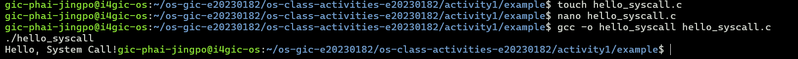

Screenshot of running `hello_winapi.c` on Windows (CMD/PowerShell/VS Code):

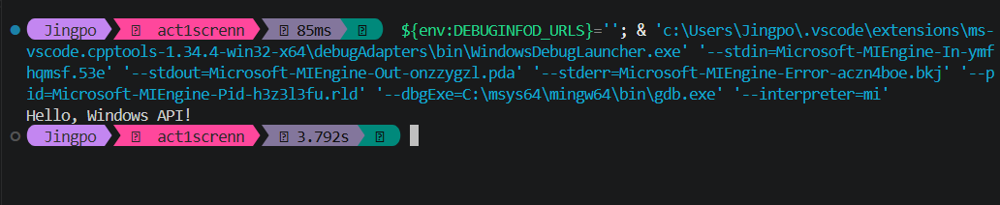

Screenshot of running `copyfilesyscall.c` on Linux:

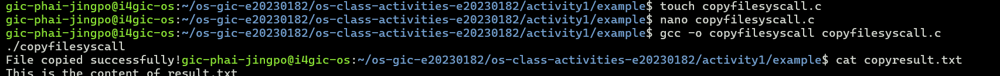

---

## Task 1: File Creator & Reader

### Part A — File Creator

**Describe your implementation:** I made two programs that create `output.txt` with a line of text. One uses `fopen`/`fprintf`/`fclose`, the other uses `open`/`write`/`close`. The library one is shorter because it handles the flags, permissions and length for me. With system calls I had to set all of that myself. The output file is the same.

**Version A — Library Functions (`file_creator_lib.c`):**

<!-- Screenshot: gcc -o file_creator_lib file_creator_lib.c && ./file_creator_lib && cat output.txt -->

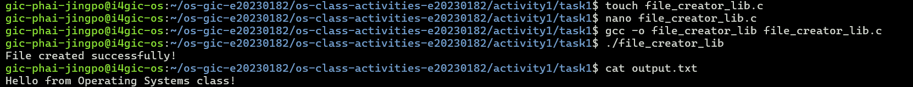

**Version B — POSIX System Calls (`file_creator_sys.c`):**

<!-- Screenshot: gcc -o file_creator_sys file_creator_sys.c && ./file_creator_sys && cat output.txt -->

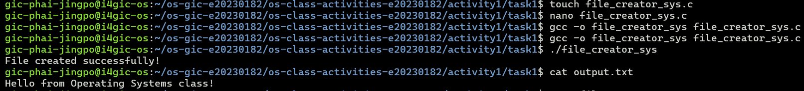

**Questions:**

1. **What flags did you pass to `open()`? What does each flag mean?**

   > `O_WRONLY | O_CREAT | O_TRUNC`. Write only, create the file if it's missing, and empty it if it already exists.

2. **What is `0644`? What does each digit represent?**

   > The file permissions in octal. 6 = owner can read and write, 4 = group can read, 4 = others can read. So it's `rw-r--r--`.

3. **What does `fopen("output.txt", "w")` do internally that you had to do manually?**

   > It turns `"w"` into the `open()` flags, calls `open()`, and creates a buffer (`FILE`) for the file. It also handles errors, so I didn't have to do any of it.

### Part B — File Reader & Display

**Describe your implementation:** Both programs read `output.txt` and print it. The library one uses `fopen` and `fgets` (line by line). The system call one uses `open` and `read` in a loop, then `write` to print the bytes it got.

**Version A — Library Functions (`file_reader_lib.c`):**

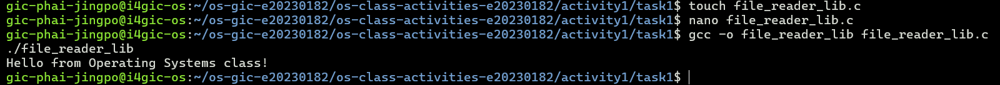

**Version B — POSIX System Calls (`file_reader_sys.c`):**

**Questions:**

1. **What does `read()` return? How is this different from `fgets()`?**

   > It returns how many bytes it read, `0` at the end of the file, or `-1` on error. `fgets()` reads one line and gives back a string, but `read()` just gives raw bytes with no line handling.

2. **Why do you need a loop when using `read()`? When does it stop?**

   > One `read()` only gets up to the buffer size (256 bytes), so a bigger file needs more calls. The loop stops when `read()` returns `0` (end of file).

---

## Task 2: Directory Listing & File Info

**Describe your implementation:** Both programs list each file in the folder with its size, using `opendir`, `readdir` and `stat`. The library one prints with `printf`. The system call one uses `snprintf` to make the text first, then `write` to print it.

### Version A — Library Functions (`dir_list_lib.c`)

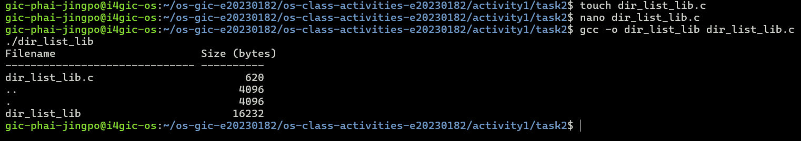

### Version B — System Calls (`dir_list_sys.c`)

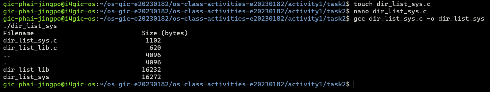

### Questions

1. **What struct does `readdir()` return? What fields does it contain?**

   > A `struct dirent`. Its main fields are `d_ino` (inode number), `d_off`, `d_reclen`, `d_type` and `d_name` (the file name).

2. **What information does `stat()` provide beyond file size?**

   > Permissions and file type, owner and group, inode number, number of links, and the access, modify and change times.

3. **Why can't you `write()` a number directly — why do you need `snprintf()` first?**

   > `write()` only sends raw bytes, so a number would come out as a binary byte, not readable digits. `snprintf()` turns the number into text first.

---

## Optional Bonus: Windows API (`file_creator_win.c`)

Screenshot of running on Windows:

### Bonus Questions

1. **Why does Windows use `HANDLE` instead of integer file descriptors?**

   > A `HANDLE` can stand for any kernel object (file, process, thread, pipe), not only files. Windows also uses it to check access rights, and it hides the real details.

2. **What is the Windows equivalent of POSIX `fork()`? Why is it different?**

   > `CreateProcess()`. It starts a new program directly, while Linux copies the process with `fork()` and then loads a program with `exec()`.

3. **Can you use POSIX calls on Windows?**

   > Not directly. You need something like WSL, Cygwin or MinGW to get them.

---

## Task 3: strace Analysis

**Describe what you observed:** The two versions did almost the same work: one `openat`, one `write` of 36 bytes to the file, and `close`. What surprised me is that `fprintf()` made only one `write()`. The library version made 38 system calls and the system call version made 34, so 4 more.

### strace Output — Library Version (File Creator)

<!-- Screenshot: strace -e trace=openat,read,write,close ./file_creator_lib -->
<!-- IMPORTANT: Highlight/annotate the key system calls in your screenshot -->

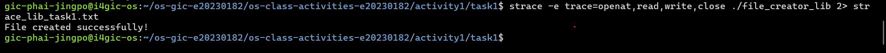

### strace Output — System Call Version (File Creator)

<!-- Screenshot: strace -e trace=openat,read,write,close ./file_creator_sys -->
<!-- IMPORTANT: Highlight/annotate the key system calls in your screenshot -->

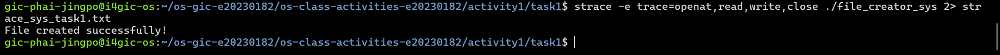

### strace Output — Library Version (File Reader or Dir Listing)

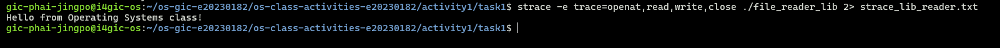

### strace Output — System Call Version (File Reader or Dir Listing)

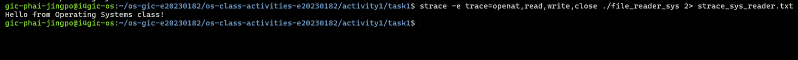

### strace -c Summary Comparison

<!-- Screenshot of `strace -c` output for both versions -->

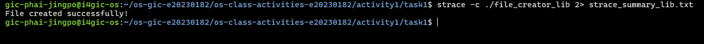
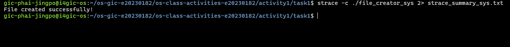

### Questions

1. **How many system calls does the library version make compared to the system call version?**

   > The library version made 38 and the system call version made 34, so 4 more (from `strace -c`).

2. **What extra system calls appear in the library version? What do they do?**

   > 2 extra `brk` (it allocates memory for the file buffer) and 2 extra `fstat` (it checks the file to decide how to buffer).

3. **How many `write()` calls does `fprintf()` actually produce?**

   > Just one. The text is kept in a buffer and written once when the file is closed.

4. **In your own words, what is the real difference between a library function and a system call?**

   > A system call is a direct request to the kernel. A library function is normal code in the C library that is easier to use and may call system calls inside it.

---

## Task 4: Exploring OS Structure

### System Information

> 📸 Screenshot of `uname -a`, `/proc/cpuinfo`, `/proc/meminfo`, `/proc/version`, `/proc/uptime`:

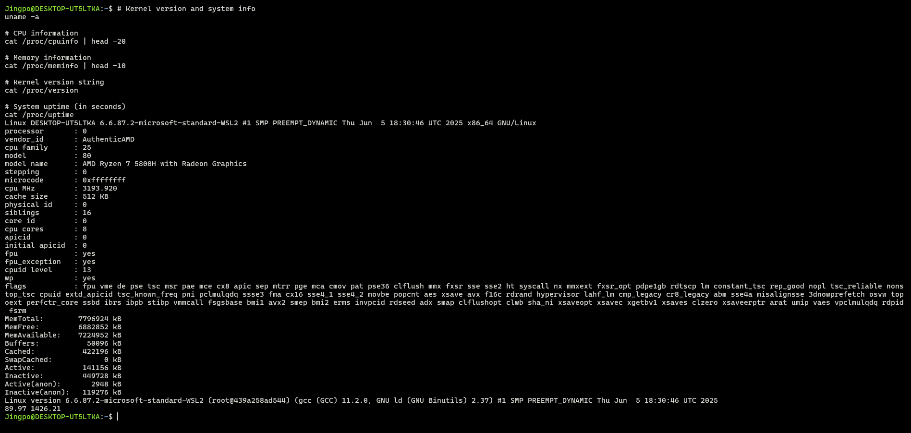

### Process Information

> 📸 Screenshot of `/proc/self/status`, `/proc/self/maps`, `ps aux`:

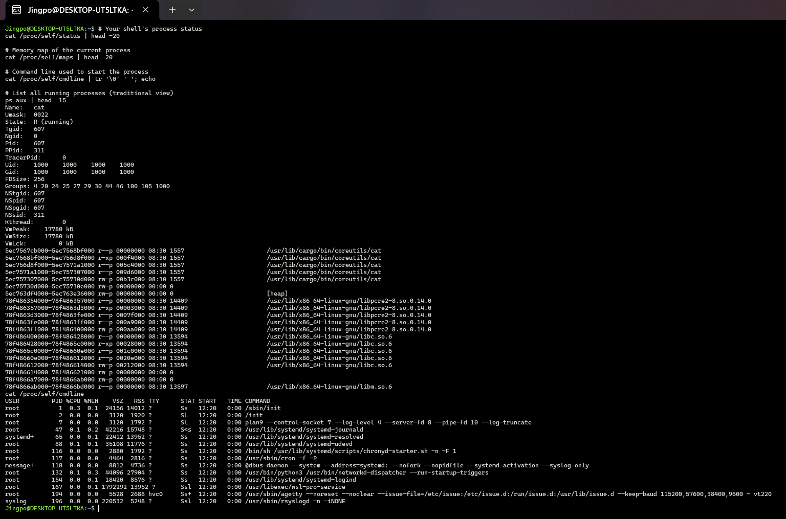

### Kernel Modules

> 📸 Screenshot of `lsmod` and `modinfo`:

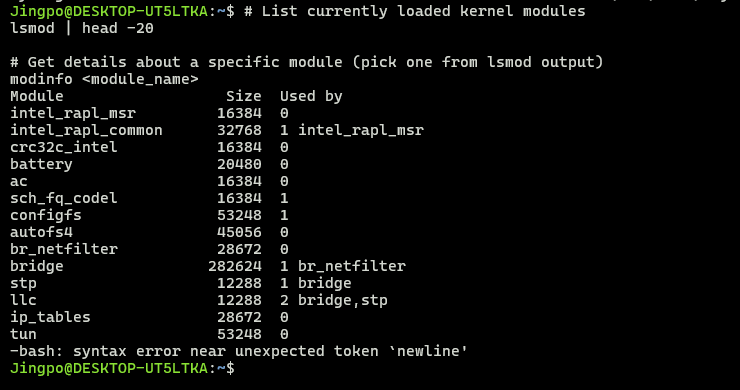

### OS Layers Diagram

> 📸 Your diagram of the OS layers, labeled with real data from your system:

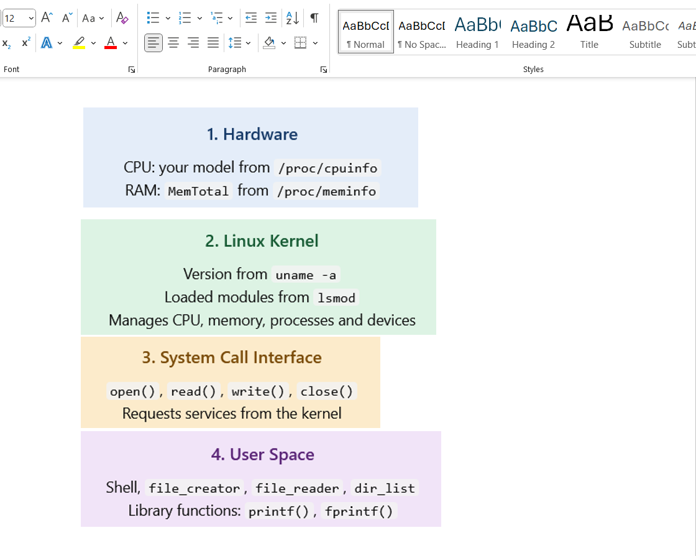

### Questions

1. **What is `/proc`? Is it a real filesystem on disk?**

   > A virtual filesystem made by the kernel. It's not on the disk. The files are created when you read them and show the system's current information.

2. **Monolithic kernel vs. microkernel — which type does Linux use?**

   > Linux is a monolithic kernel. Everything runs in one big kernel, but it can load modules (like in `lsmod`).

3. **What memory regions do you see in `/proc/self/maps`?**

   > The program's code and data (`cat`), the `[heap]`, and shared libraries like `libc.so.6`, `libm.so.6` and `libpcre2`. Each has permissions such as `r-xp` for code and `rw-p` for data.

4. **Break down the kernel version string from `uname -a`.**

   > `Linux` is the kernel, `DESKTOP-UT5LTKA` is the hostname, `6.6.87.2` is the kernel version, `microsoft-standard-WSL2` shows it's the WSL2 kernel, `#1 SMP PREEMPT_DYNAMIC` is the build type, `Jun 5 2025` is the build date, and `x86_64` is the architecture.

5. **How does `/proc` show that the OS is an intermediary between programs and hardware?**

   > Programs don't touch the hardware directly. They read `/proc` files, and the kernel gives them the CPU, memory and process info, so the kernel sits between the programs and the hardware.

---

## Reflection

What did you learn from this activity? What was the most surprising difference between library functions and system calls?

> I learned that library functions like `fopen` and `printf` are built on top of system calls like `open` and `write`. The most surprising thing was that `fprintf()` only made one `write()` because of buffering, and the library version used 4 more system calls than the direct one. Using `strace` helped me see what really happens inside a program.
