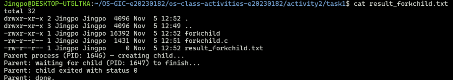
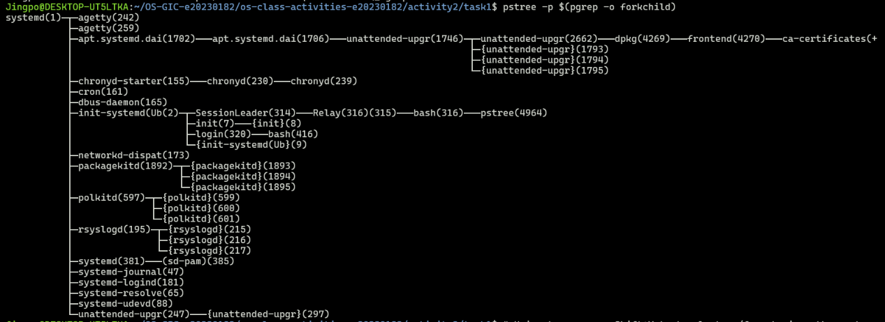
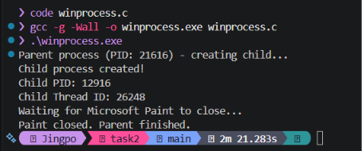
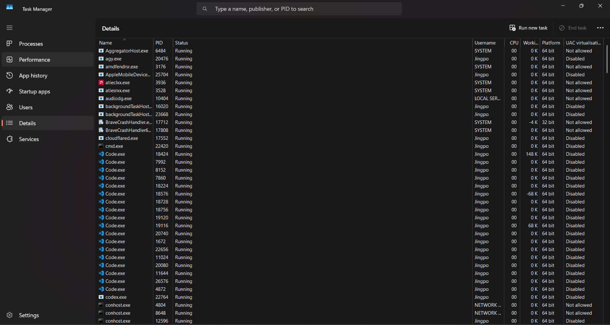
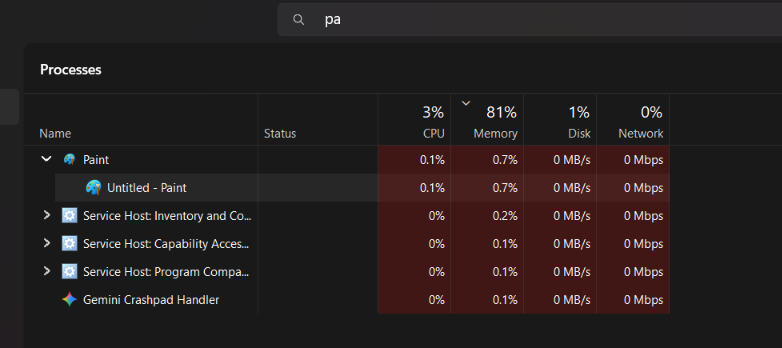
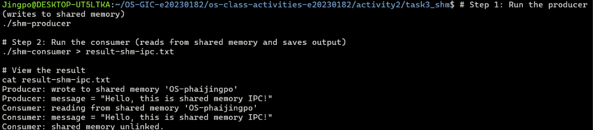
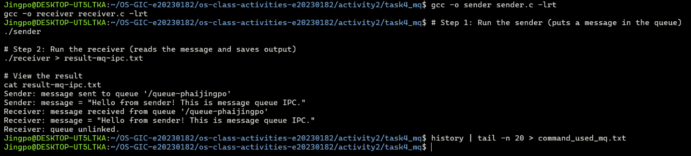

# Class Activity 2 — Processes & Inter-Process Communication

- **Student Name:** [PHAI JINGPO]
- **Student ID:** [e20230182]
- **Date:** [05/11/2026]

---

## Task 1: Process Creation on Linux (fork + exec)

### Compilation & Execution

Screenshot of compiling and running `forkchild.c`:



### Process Tree

Screenshot of the parent-child process tree (using `ps --forest`, `pstree`, or `htop` tree view):



### Output

```
[total 32
drwxr-xr-x 2 Jingpo Jingpo  4096 Nov  5 12:52 .
drwxr-xr-x 3 Jingpo Jingpo  4096 Nov  5 12:49 ..
-rwxr-xr-x 1 Jingpo Jingpo 16392 Nov  5 12:52 forkchild
-rw-r--r-- 1 Jingpo Jingpo  1431 Nov  5 12:51 forkchild.c
-rw-r--r-- 1 Jingpo Jingpo     0 Nov  5 12:52 result_forkchild.txt
Parent process (PID: 1646) — creating child...
Parent: waiting for child (PID: 1647) to finish...
Parent: child exited with status 0
Parent: done.
]
```

### Questions

1. **What does `fork()` return to the parent? What does it return to the child?**

   > [`fork()` returns the child's PID to the parent, 0 to the child, and -1 on failure.]

2. **What happens if you remove the `waitpid()` call? Why might the output look different?**

   > [Without `waitpid()`, the parent may finish before the child, causing the output to appear in a different order.]

3. **What does `execlp()` do? Why don't we see "execlp failed" when it succeeds?**

   > [`execlp()` replaces the current process with a new program. We don't see "execlp failed" because it only returns if an error occurs.]

4. **Draw the process tree for your program (parent → child). Include PIDs from your output.**

   > [PID: 1646]

5. **Which command did you use to view the process tree (`ps --forest`, `pstree`, or `htop`)? What information does each column show?**

   > [my computer not work]

---

## Task 2: Process Creation on Windows

### Compilation & Execution

Screenshot of compiling and running `winprocess.c`:



### Task Manager Screenshots

Screenshot showing process tree in the **Processes** tab (mspaint nested under your program):



Screenshot showing PID and Parent PID in the **Details** tab:



### Questions

1. **What is the key difference between how Linux creates a process (`fork` + `exec`) and how Windows does it (`CreateProcess`)?**

   > [Linux uses `fork()` to create a child process and `exec()` to run a new program. Windows uses `CreateProcess()` to create and start a new process in one step.]

2. **What does `WaitForSingleObject()` do? What is its Linux equivalent?**

   > [`WaitForSingleObject()` waits for a process to finish. Its Linux equivalent is `waitpid()`.]

3. **Why do we need to call `CloseHandle()` at the end? What happens if we don't?**

   > [`CloseHandle()` releases Windows process and thread handles. Without it, resource leaks may occur.]

4. **In Task Manager, what was the PID of your parent program and the PID of mspaint? Do they match your program's output?**

   > [The parent PID was [21616] and the Paint PID was [12916]. Yes, they matched my program's output.]

5. **Compare the Processes tab (tree view) and the Details tab (PID/PPID columns). Which view makes it easier to understand the parent-child relationship? Why?**

   > [The Processes tab makes it easier because it visually shows the parent-child relationship as a tree. The Details tab is better for checking exact PIDs.]

---

## Task 3: Shared Memory IPC

### Compilation & Execution

Screenshot of compiling and running `shm-producer` and `shm-consumer`:



### Output

```
[Consumer: reading from shared memory 'OS-phaijingpo'
Consumer: message = "Hello, this is shared memory IPC!"
Consumer: shared memory unlinked.
]
```

### Questions

1. **What does `shm_open()` do? How is it different from `open()`?**

   > [`shm_open()` creates or opens shared memory for communication between processes, while `open()` opens regular files.]

2. **What does `mmap()` do? Why is shared memory faster than other IPC methods?**

   > [`mmap()` maps shared memory into a process's address space. Shared memory is faster because processes access data directly without repeated copying.]

3. **Why must the shared memory name match between producer and consumer?**

   > [The names must match so both processes can access the same shared memory and exchange data.]

4. **What does `shm_unlink()` do? What would happen if the consumer didn't call it?**

   > [`shm_unlink()` removes the shared memory object. Without it, the object remains in the system and may waste resources.]

5. **If the consumer runs before the producer, what happens? Try it and describe the error.**

   > [If the consumer runs before the producer, `shm_open()` fails because the shared memory does not exist. Error: `shm_open: No such file or directory`]

---

## Task 4: Message Queue IPC

### Compilation & Execution

Screenshot of compiling and running `sender` and `receiver`:



### Output

```
[Paste the content of result-mq-ipc.txt here]
```

### Questions

1. **How is a message queue different from shared memory? When would you use one over the other?**

   > [Your answer]

2. **Why does the queue name in `common.h` need to start with `/`?**

   > [Your answer]

3. **What does `mq_unlink()` do? What happens if neither the sender nor receiver calls it?**

   > [Your answer]

4. **What happens if you run the receiver before the sender?**

   > [Your answer]

5. **Can multiple senders send to the same queue? Can multiple receivers read from the same queue?**

   > [Your answer]

---

## Reflection

What did you learn from this activity? What was the most interesting difference between Linux and Windows process creation? Which IPC method do you prefer and why?

> [Write your reflection here]
