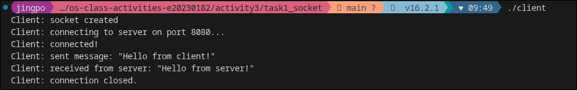
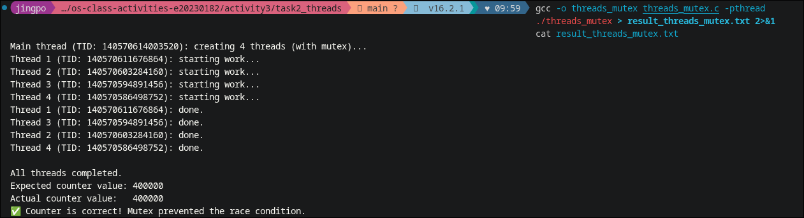
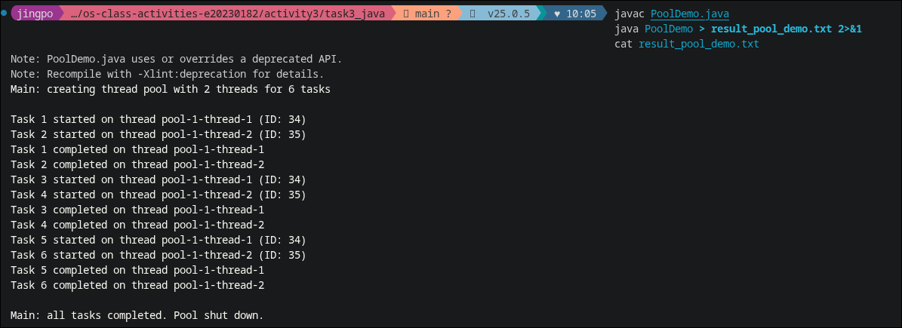

# Class Activity 3 — Socket Communication & Multithreading

- **Student Name:** [PHAI JINGPO]
- **Student ID:** [e20230182]
- **Date:** [14/11/2026]

---

## Task 1: TCP Socket Communication (C)

### Compilation & Execution

### Answers

1. **Role of `bind()` / Why client doesn't call it:**
   > `bind()` assigns an IP address and port to the server. The client doesn't need it because the OS automatically assigns them.

2. **What `accept()` returns:**
   > `accept()` returns a new socket descriptor for communicating with the client. The original socket keeps listening for connections.
3. **Starting client before server:**
   > The client gets a `Connection refused` error because the server is not running.

4. **What `htons()` does:**
   > `htons()` converts the port number from host byte order to network byte order (big-endian).

5. **Socket call sequence diagram:**
   > SERVER                 CLIENT
socket()               socket()
   |                      |
bind()                    |
   |                      |
listen()                  |
   |                      |
accept() <----------- connect()
   |                      |
read()   <------------ send()
   |                      |
send()   ------------> read()
   |                      |
close()                close()

---

## Task 2: POSIX Threads (C)

### Output — Without Mutex (Race Condition)

### Output — With Mutex (Correct)

_Main thread (TID: 140570614003520): creating 4 threads (with mutex)...
Thread 1 (TID: 140570611676864): starting work...
Thread 2 (TID: 140570603284160): starting work...
Thread 3 (TID: 140570594891456): starting work...
Thread 4 (TID: 140570586498752): starting work...
Thread 1 (TID: 140570611676864): done.
Thread 3 (TID: 140570594891456): done.
Thread 2 (TID: 140570603284160): done.
Thread 4 (TID: 140570586498752): done._

### Answers

1. **What is a race condition?**
   > A race condition happens when multiple threads access and modify shared data at the same time, causing incorrect results.

2. **What does `pthread_mutex_lock()` do?**
   >`pthread_mutex_lock()` locks shared data so only one thread can access it at a time, preventing race conditions.

3. **Removing `pthread_join()`:**
   > Without `pthread_join()`, the main thread may finish before the worker threads, causing incomplete execution.

4. **Thread vs Process:**
   > A process has its own memory, while threads share the same process memory but each has its own stack and registers.

---

## Task 3: Java Multithreading

### ThreadDemo Output

### RunnableDemo Output

_Note: RunnableDemo.java uses or overrides a deprecated API.
Note: Recompile with -Xlint:deprecation for details.
Main: creating threads with Runnable interface

[Download] Step 1 (Thread: downloader, ID: 34)
[Process] Step 1 (Thread: processor, ID: 35)
[Upload] Step 1 (Thread: uploader, ID: 36)
[Download] Step 2 (Thread: downloader, ID: 34)
[Process] Step 2 (Thread: processor, ID: 35)
[Upload] Step 2 (Thread: uploader, ID: 36)
[Download] Step 3 (Thread: downloader, ID: 34)
[Process] Step 3 (Thread: processor, ID: 35)
[Upload] Step 3 (Thread: uploader, ID: 36)

Main: all tasks completed._

### PoolDemo Output

_Note: PoolDemo.java uses or overrides a deprecated API.
Note: Recompile with -Xlint:deprecation for details.
Main: creating thread pool with 2 threads for 6 tasks

Task 1 started on thread pool-1-thread-1 (ID: 34)
Task 2 started on thread pool-1-thread-2 (ID: 35)
Task 1 completed on thread pool-1-thread-1
Task 2 completed on thread pool-1-thread-2
Task 3 started on thread pool-1-thread-1 (ID: 34)
Task 4 started on thread pool-1-thread-2 (ID: 35)
Task 3 completed on thread pool-1-thread-1
Task 4 completed on thread pool-1-thread-2
Task 5 started on thread pool-1-thread-1 (ID: 34)
Task 6 started on thread pool-1-thread-2 (ID: 35)
Task 5 completed on thread pool-1-thread-1
Task 6 completed on thread pool-1-thread-2

Main: all tasks completed. Pool shut down.
_

### Answers

1. **Thread vs Runnable:**
   > `Thread` creates a thread by extending the Thread class, while `Runnable` defines a task that a thread runs. `Runnable` is more flexible.
2. **Pool size limiting concurrency:**
   > Only 2 tasks run at the same time because the thread pool has 2 worker threads. The other 4 tasks wait in a queue.
3. **thread.join() in Java:**
   >`thread.join()` makes the main thread wait until a worker thread finishes. Without it, the main thread may finish first.
4. **ExecutorService advantages:**
   > `ExecutorService` manages threads efficiently, reuses threads, and reduces the overhead of creating new threads.

---

## Task 4: Observing Threads

### Linux — `ps -eLf` Output

_(Paste the relevant ps output here)_

### Linux — htop Thread View

### Linux — htop Kernel Threads (tree view, `kthreadd`)

### Linux — Kernel Threads (commands)

_(Paste the output of `ps -L ...` and `ps --ppid 2 ...` here)_

### Windows — Task Manager

### Answers

1. **LWP column meaning:**
   > _Your answer_

2. **/proc/PID/task/ count:**
   > _Your answer_

3. **Extra Java threads:**
   > _Your answer_

4. **Linux vs Windows thread viewing:**
   > _Your answer_

5. **kthreadd and three kernel threads:**
   > _Your answer_

6. **TID equal to PID, NLWP and cores:**
   > _Your answer_

7. **`H` and `K` in htop:**
   > _Your answer_

---

## Reflection

> _What did you find most interesting about socket communication and threading? How does understanding threads at the OS level help you write better concurrent programs?_