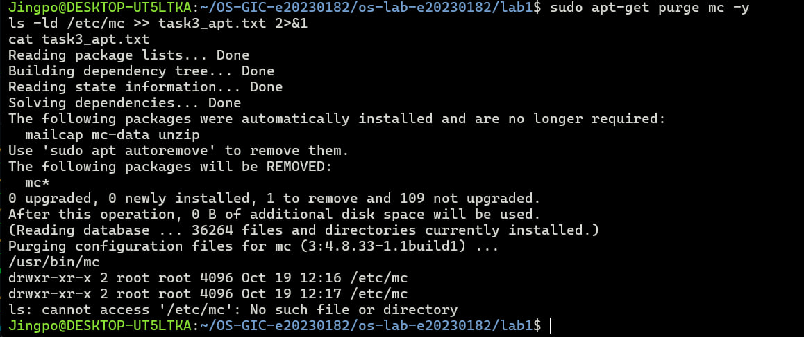
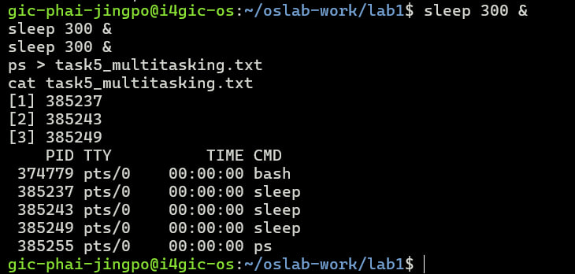
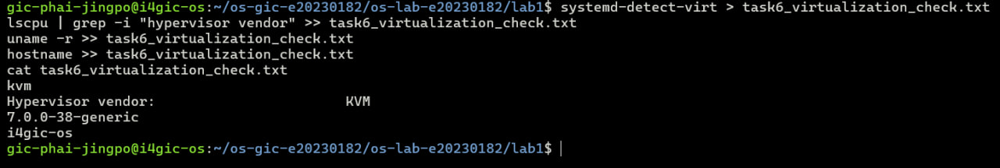

# OS Lab 1 Submission

Copy this template to `os-lab-e20230182/lab1/README.md` in your own repository. Follow [the instructions](lab1-instruction.md). Your prediction and checkpoint answers are already saved by `oslab`; do not copy them here.

- **Student Name:PHAI JINGPO**
- **Student ID: e20230182**
- **Ubuntu username on the server: gic-phai-jingpo@i4gic-os**
- **My values** (`oslab values lab1`): file1 =rocket , file2 =pencil , count =3

---

## Task 1: Operating System Identification

Briefly describe what you observed about your OS and kernel. Which number is the kernel version, and which is the distribution version?

<!-- You may show the contents of task1_os_info.txt here; no screenshot needed. -->
`uname -a` and `lsb_release -a` showed the kernel and the distribution. The kernel is the core that controls the hardware. Ubuntu is the distribution: the kernel plus many other programs.

- **Kernel version: Linux i4gic-os 7.0.0-38-generic** 
- **Ubuntu version: Ubuntu 26.04.1 LTS** 

---

## Task 2: Essential Linux File and Directory Commands

Briefly describe your experience creating, copying, renaming and deleting files. What did the last `ls` show?

<!-- You may show the contents of task2_file_commands.txt here; no screenshot needed. -->
I made the folder `task2_files` and created `rocket.txt` and `pencil.txt` with one line in each. Then I copied `rocket.txt`, renamed `pencil.txt` to `pencil_renamed.txt`, and deleted the copy. After each step I saved `ls` into `task2_file_commands.txt`. The last `ls` showe:

    pencil_renamed.txt
    rocket.txt
---

## Task 3: Package Management Using APT

Explain the difference you observed between `remove` and `purge`.

<!-- SCREENSHOT REQUIREMENT: your terminal after the purge, showing `ls -ld /etc/mc` and your prompt. -->

I installed `mc` and saved its path and the state of `/etc/mc`. Then I ran `remove` and `purge` and checked `/etc/mc` after each.

- After `remove`, the program was gone but `/etc/mc` was still there (settings kept).
- After `purge`, `/etc/mc` was deleted, and `ls -ld /etc/mc` printed "No such file or directory".

So `remove` keeps the settings in `/etc`, and `purge` deletes them too.

---

## Task 4: Programs vs Processes

Briefly describe how you ran a background process and found it in the process list. What is the difference between a program and a process? What did you see before, during and after?

- before running sleep is a program store in path:/usr/bin/sleep. 
- Running ps lists sleep with PID 380413
- After run : ps shows only bash and ps, and [1]+ Done sleep 30 appears. then the program is still in path:/usr/bin/sleep 
--- 

## Task 5: Multitasking

Briefly describe the multitasking you saw. How many `sleep` lines did `ps` show? What does that show about the system, and what does it **not** show about how the processor is shared?

I started 3 copies of `sleep 300` in the background, then ran `ps` and saved the list in `task5_multitasking.txt`. `ps` showed 3 `sleep` lines at the same time, each with its own PID. This shows that the system can keep several processes alive at once (multitasking). It does **not** show how the processor is shared between them, because `sleep` only waits and uses no processor time

---

## Task 6: Virtualization and Hypervisor Detection

State whether your system is running on a virtual machine or physical hardware, based on the command outputs.

- line 1 kvm	The server is a virtual machine.
- line 2 Hypervisor vendor: KVM	The hypervisor (the program that runs VMs) is KVM
- line 3 7.0.0-38-generic	Kernel version
- line 4 i4gic-os	Hostname

---

## My Prediction: Confirmed or Corrected

For each prediction answer (`oslab predict lab1`), write **confirmed** or **corrected** and what you saw that shows it. You test the third answer (`apt-get remove`) in Task 3.

---

## Plus / Challenge (only if you did them)

Your answers.

## AI Note (optional)

One suggestion an AI tool gave you and how you checked it.
